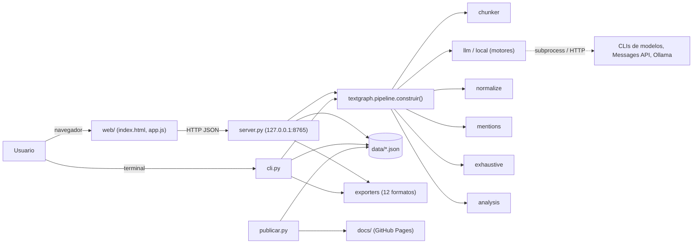

# textgraph

Convierte un texto en un **grafo de conocimiento exhaustivo**: las entidades son
los nodos, las relaciones son las aristas, y ninguna entidad se queda suelta.
Incluye una interfaz web local para explorar y editar el grafo, una línea de
comandos y exportadores a los formatos abiertos habituales (Gephi, Neo4j,
Graphviz, RDF, Mermaid…), además de un «paquete para LLM» pensado para que otro
modelo siga analizando el resultado.

Pensado para uso educativo: cada relación conserva la **cita literal del texto**
que la justifica, y el visor permite ir del grafo al texto y del texto al grafo.

**▶ Grafos de ejemplo, explorables en el navegador:
[lapeyus.github.io/textgraph](https://lapeyus.github.io/textgraph/)**

## Funciones principales

- **Extracción con modelo** de entidades (12 tipos) y relaciones con evidencia
  literal, usando la CLI de un proveedor ya autenticada (`claude`, `codex`,
  `gemini`, `agy`), la Messages API de Anthropic, un servidor Ollama local o,
  sin red, un motor heurístico de reglas.
- **Fusión de duplicados** por reglas (acentos, artículos, siglas, apellidos,
  plurales) y, opcionalmente, asistida por el modelo.
- **Garantía de exhaustividad**: cascada de reparación que deja el grafo con
  cero nodos sueltos y un único componente conexo, marcando cada arista según
  su respaldo textual.
- **Métricas de red**: grado, PageRank, intermediación (Brandes) y comunidades
  por modularidad.
- **Visor web** con detalle, texto con menciones resaltadas, listados, informe
  de construcción, filtros y edición manual.
- **12 formatos de exportación**, incluido un HTML autónomo que funciona sin
  servidor ni conexión.
- **Cero dependencias**: solo la biblioteca estándar de Python; la librería de
  visualización (vis-network) va incluida en `web/vendor/`.

## Arquitectura en una imagen



Detalle en [docs/ARCHITECTURE.md](docs/ARCHITECTURE.md).

## Inicio rápido

### Requisitos

- Python 3.8 o superior (basta el que trae macOS; verificado con 3.9 y 3.12).
- **Ninguna dependencia externa**.
- Para la extracción con modelo, alguna de estas cosas:
  - la CLI `claude` instalada y con sesión iniciada (opción por defecto, no
    necesita clave de API),
  - la CLI `codex` de OpenAI instalada y con sesión iniciada,
  - la CLI `gemini` de Google instalada y con sesión iniciada,
  - la CLI `agy` de Antigravity (Google) instalada y con sesión iniciada
    (`curl -fsSL https://antigravity.google/cli/install.sh | bash`),
  - la variable de entorno `ANTHROPIC_API_KEY` con una clave de la API, o
  - un servidor [Ollama](https://ollama.com) local (solo desde la terminal o en
    modo `auto`; ver más abajo).

Sin ninguna de ellas, la aplicación sigue funcionando con el motor
heurístico local (sin red, sin coste y con bastante menos precisión).

### Arranque de la interfaz

```bash
git clone https://github.com/Lapeyus/textgraph.git
cd textgraph
python3 server.py
```

Se abre `http://127.0.0.1:8765/` en el navegador. En macOS también sirve hacer
doble clic en `iniciar.command`.

Opciones: `--puerto 9000`, `--host 0.0.0.0`, `--sin-navegador`.
El servidor escucha solo en `127.0.0.1` salvo que se indique otra cosa (no
tiene autenticación: no lo expongas a una red que no controles).

### Uso de la interfaz

1. Pega el texto (o abre un `.txt` / `.md`) en el panel izquierdo.
2. Ajusta las opciones si quieres: motor, modelo, tamaño de fragmento,
   fragmentos en paralelo, exhaustividad asistida, fusión de duplicados.
   Debajo del botón aparece una estimación orientativa de llamadas y coste.
3. Pulsa **Construir grafo**.
4. Explora:
   - **Detalle**: tipo, alias, métricas, relaciones entrantes y salientes,
     y las apariciones de la entidad en el texto.
   - **Texto**: el texto original con cada mención resaltada; al pulsar una
     mención se selecciona el nodo correspondiente.
   - **Listados**: tablas de entidades y relaciones, ordenables y clicables.
   - **Informe**: cómo se construyó el grafo y qué decisiones se tomaron.
   - **Filtros**: por tipo de entidad, tipo de relación, confianza mínima y
     vecindario de un nodo (con profundidad configurable).
   - **✎ Editar**: añadir, corregir o borrar nodos y relaciones a mano y guardar.
5. **⤓ Exportar** ofrece los doce formatos de salida.

### Uso desde la terminal

```bash
python3 cli.py texto.txt                       # json + html + paquete LLM
python3 cli.py texto.txt -f graphml -o salida/
python3 cli.py texto.txt -m local              # sin modelo, sin coste
python3 cli.py texto.txt -m codex-cli --modelo gpt-5.6-terra
python3 cli.py texto.txt -m gemini-cli --modelo gemini-3-flash-preview
python3 cli.py texto.txt -m antigravity-cli --modelo gemini-3.7-flash-high
python3 cli.py texto.txt -m ollama             # servidor Ollama local
cat texto.txt | python3 cli.py - --modelo claude-sonnet-5
python3 cli.py --listar-formatos
```

Opciones útiles: `--fragmento 2500` (tamaño del fragmento), `--paralelo 3`
(fragmentos simultáneos), `--sin-exhaustividad`, `--fusion-llm`, `--no-guardar`.
La referencia completa de argumentos está en [docs/SPEC.md](docs/SPEC.md#cli).

## Estructura del repositorio

```
textgraph/
├── server.py            interfaz web + API HTTP (biblioteca estándar)
├── cli.py               línea de comandos
├── publicar.py          genera el sitio estático de GitHub Pages en docs/
├── pruebas.py           comprobaciones integrales sin modelo (script)
├── iniciar.command      lanzador de doble clic para macOS
├── textgraph/           el motor
│   ├── pipeline.py      orquestación texto → grafo
│   ├── chunker.py       oraciones, fragmentos solapados, búsqueda de citas
│   ├── llm.py           motores (CLIs, API, Ollama), precios, parseo de JSON
│   ├── prompts.py       prompts de extracción, reconciliación, puentes y fusión
│   ├── local.py         motor heurístico sin LLM
│   ├── normalize.py     resolución de entidades y normalización de predicados
│   ├── mentions.py      índice de menciones en el texto original
│   ├── exhaustive.py    cascada de exhaustividad
│   ├── analysis.py      PageRank, intermediación, comunidades
│   ├── exporters.py     12 formatos de salida
│   ├── model.py         Node, Edge, Graph y serialización
│   └── store.py         persistencia: un JSON por grafo en data/
├── web/                 interfaz (index.html, style.css, app.js, ejemplo.txt, vendor/)
├── tests/               pruebas unitarias (unittest)
├── examples/            textos de ejemplo
├── data/                grafos guardados (solo .gitkeep va a git)
└── docs/                sitio de GitHub Pages + documentación técnica
    ├── index.html, grafos/   sitio generado por publicar.py
    ├── ARCHITECTURE.md       arquitectura y flujos
    ├── SPEC.md               requisitos, contratos HTTP/CLI y formatos
    └── TESTING.md            estrategia y suites de pruebas
```

## Configuración

No hay archivo de configuración: todo se controla con argumentos de línea de
comandos y variables de entorno.

| Variable | Uso |
|---|---|
| `ANTHROPIC_API_KEY` | habilita el motor `api` (Messages API). |
| `OLLAMA_HOST` | dirección del servidor Ollama (por defecto `http://localhost:11434`; acepta la forma `0.0.0.0:11434`). |
| `TEXTGRAPH_VERBOSE` | si tiene valor, el servidor registra cada petición HTTP en stderr. |
| `GEMINI_API_KEY` | la lee la propia CLI `gemini` si se autentica con clave (textgraph no la usa directamente). |

Archivos locales que **no** van a git (ver `.gitignore`): `data/*.json` (los
grafos guardados incluyen el texto completo de entrada y pueden contener
material privado), `entradas/` (documentos de entrada de terceros),
`__pycache__/`, `.DS_Store` y `._*`. Si los grafos te importan, respáldalos tú
mismo: el repositorio no los conserva.

## Exhaustividad: por qué ningún nodo queda aislado

El planteamiento es que si algo aparece en un texto, guarda alguna relación con
lo demás; si el grafo lo deja suelto, es un fallo de la extracción, no del
texto. Tras la extracción se aplica una cascada de reparación, de más a menos
respaldo textual, y cada arista queda marcada con el tipo que le corresponde:

| Tipo de relación | Origen | Cómo se lee |
|---|---|---|
| `explicita` | el texto la afirma literalmente | fiable |
| `implicita` | deducida por el modelo (correferencia, contexto) | razonable |
| `coocurrencia` | las entidades comparten oración, sin predicado explícito | débil |
| `estructural` | último recurso para no dejar nodos sueltos | muy débil |

La cascada es: co-ocurrencia en la misma oración → reconciliación asistida por
el modelo (se le muestran las entidades sueltas con su contexto y el catálogo
del grafo) → co-ocurrencia en oraciones cercanas → enlace estructural al nodo
más central. Después se unen los componentes desconectados con el mismo
criterio. El resultado siempre es **un único componente conexo y cero nodos
sueltos**, y el panel *Informe* dice exactamente cuántas aristas puso cada paso.

Si prefieres ver el grafo «crudo», desmarca la exhaustividad asistida y filtra
por tipo de relación en el visor: las aristas débiles se distinguen a simple
vista (línea discontinua o punteada).

## Formatos de exportación

| Formato | Id | Extensión | Para qué |
|---|---|---|---|
| JSON nativo | `json` | `.json` | grafo completo con evidencias, menciones y métricas |
| GraphML | `graphml` | `.graphml` | Gephi, yEd, Cytoscape, NetworkX |
| GEXF | `gexf` | `.gexf` | Gephi |
| CSV de nodos / aristas | `csv-nodes` / `csv-edges` | `.nodes.csv` / `.edges.csv` | hojas de cálculo, Gephi |
| Cypher | `cypher` | `.cypher` | importar en Neo4j |
| DOT | `dot` | `.dot` | Graphviz (`dot -Tpdf grafo.dot -o grafo.pdf`) |
| Mermaid | `mermaid` | `.mmd` | Markdown, Obsidian, documentación |
| RDF Turtle | `turtle` | `.ttl` | web semántica, SPARQL |
| JSON-LD | `jsonld` | `.jsonld` | datos enlazados |
| Paquete para LLM | `llm` | `.llm.md` | pasarle el grafo a otro modelo |
| HTML autónomo | `html` | `.html` | visor interactivo en un solo archivo, sin servidor |

El HTML autónomo lleva dentro los datos (incluido el texto original) y la
librería de visualización: se puede enviar por correo o subir a cualquier sitio
y funciona sin conexión.

## Motores y coste

| Motor | Requisito | Coste | Calidad |
|---|---|---|---|
| `claude-cli` (por defecto) | CLI `claude` con sesión | se carga a tu cuenta de Claude | alta |
| `codex-cli` | CLI `codex` con sesión | se carga a tu cuenta de ChatGPT/OpenAI | alta |
| `gemini-cli` | CLI `gemini` con sesión | se carga a tu cuenta de Google | alta |
| `antigravity-cli` | CLI `agy` con sesión | cuota del plan de Antigravity (Google) | alta |
| `api` | `ANTHROPIC_API_KEY` | tarifa de la Messages API | alta |
| `ollama` | servidor Ollama local | cero (cómputo propio) | depende del modelo |
| `local` | nada | cero | orientativa |

En `auto` se elige el primero disponible en ese orden: `claude-cli`, `api`,
`codex-cli`, `gemini-cli`, `antigravity-cli`, `ollama` y, si no hay nada,
`local`. Cada motor tiene su propia lista de modelos: los Claude para
`claude-cli` y `api`, la familia GPT de la CLI `codex` (`gpt-5.6-sol`,
`gpt-5.6-terra`, `gpt-5.6-luna`) para `codex-cli`, los Gemini
(`gemini-3.1-pro-preview`, `gemini-3-pro-preview`, `gemini-3-flash-preview`,
`gemini-2.5-pro`) para `gemini-cli`, el catálogo de Antigravity (Gemini
3.7/3.6/3.5 Flash y 3.1 Pro con esfuerzo de razonamiento a elegir, Claude
Sonnet/Opus 4.6 y GPT-OSS 120B) para `antigravity-cli`, y cualquier modelo
descargado en Ollama (por defecto `gemma4:12b-mlx`) para `ollama`. El motor
`ollama` todavía no aparece en el selector de la interfaz web: se usa con
`-m ollama` en la terminal o cuando `auto` lo elige.

Medición real sobre un texto de 1 626 caracteres (un fragmento):

| Modelo | Coste | Tiempo | Resultado |
|---|---|---|---|
| `claude-opus-5` (por defecto) | ≈ 0,29 $ | ≈ 95 s | 55 nodos, 62 relaciones |
| `claude-sonnet-5` | ≈ 4 veces menos | ≈ 20 s | calidad muy parecida |

Para textos largos, `claude-sonnet-5` suele ser la opción sensata; el modelo se
elige en el desplegable de la interfaz o con `--modelo` en la terminal.

### Qué significan esas cifras según cómo estés autenticado

La CLI `claude` informa de un `total_cost_usd` por llamada y la aplicación lo
muestra como «coste equivalente». **No siempre es un cargo**:

- **Sesión de suscripción** (Pro o Max, `billingType: stripe_subscription`): no
  hay facturación por token. El uso se descuenta de los límites del plan —la
  ventana móvil de unas 5 horas y el tope semanal—, y la cifra en dólares es
  solo el equivalente a tarifa de API, útil para comparar modelos. Al agotar el
  límite la CLI devuelve un error y hay que esperar a la siguiente ventana;
  nunca cobra de más, salvo que el «uso extra» esté activado en la cuenta.
- **Clave de API** (`ANTHROPIC_API_KEY`, motor `api`): ahí sí es un cargo real
  a la cuenta de facturación de la consola.

Para saber en cuál estás: si `echo $ANTHROPIC_API_KEY` está vacío y en
`~/.claude.json` figura `"billingType": "stripe_subscription"`, estás en el
primer caso. Con suscripción, el recurso escaso es la **cuota**, no el dinero:
`claude-opus-5` gasta unas cinco veces más cuota que `claude-sonnet-5` por el
mismo texto, así que para lotes largos conviene Sonnet.

Con el motor `codex-cli` pasa lo mismo: la CLI `codex` no informa de coste,
así que la aplicación lo calcula a tarifa de la API de OpenAI (contando la
entrada cacheada al 10 %). Si la sesión es de ChatGPT (`codex login` con la
cuenta), el uso se descuenta de los límites del plan y no se factura aparte;
solo es un cargo real si la CLI está autenticada con una clave de API.

Y con `gemini-cli`, ídem a tarifa de la Gemini API. Con sesión de Google
(OAuth) el uso sale de la cuota del plan de la cuenta; solo es un cargo real
si la CLI usa una clave (`GEMINI_API_KEY`). Ojo: Google está retirando el
acceso OAuth «individual» de esta CLI en favor de Antigravity; si la CLI
devuelve `IneligibleTierError`, toca autenticarla con clave de API o pasarse
al motor `antigravity-cli`.

El motor `antigravity-cli` nunca factura por token: el consumo sale de la
cuota del plan de Antigravity de la cuenta de Google. La cifra en dólares es
el equivalente a la tarifa pública de API del modelo subyacente, para poder
comparar (GPT-OSS no tiene tarifa pública y se contabiliza a cero).

El motor `ollama` contabiliza tokens pero su coste equivalente es siempre cero.

### Precauciones al invocar las CLIs

El motor `claude-cli` lanza la CLI con las herramientas, los ajustes de usuario
y los servidores MCP desactivados. No es cosmético: sin esa precaución cada
llamada arrastra decenas de miles de tokens de contexto y cuesta unas 50 veces
más. El motor `codex-cli` toma las mismas precauciones: `codex exec` con
sandbox de solo lectura, sin la configuración del usuario, sin `AGENTS.md` y
sin dejar sesiones guardadas. Aun así, la CLI `codex` añade por sí sola unos
12 000 tokens de instrucciones propias en cada llamada (en su mayoría
cacheados, que se cobran a la décima parte). El motor `gemini-cli` hace lo
propio: modo `plan` (solo lectura), sin extensiones, y con `GEMINI_SYSTEM_MD`
apuntando a nuestro prompt de sistema, lo que además sustituye a las
instrucciones de agente de la CLI y se ahorra esos tokens. Y el motor
`antigravity-cli` invoca `agy` en modo impresión sin expansión de skills ni
comandos (los permisos de herramientas se deniegan solos en ese modo); la CLI
añade unos 13 000 tokens de instrucciones propias por llamada.

## Cómo funciona por dentro

1. **Segmentación** (`chunker.py`): corta por oraciones respetando abreviaturas
   y agrupa en fragmentos solapados, conservando los desplazamientos del texto.
2. **Extracción** (`llm.py`, `prompts.py`): por cada fragmento se pide al modelo
   un JSON con entidades (etiqueta, tipo, alias, descripción, evidencia) y
   relaciones (origen, predicado, destino, tipo, confianza, evidencia). A cada
   oleada de fragmentos se le pasa la lista de entidades ya conocidas para que
   reutilice las mismas etiquetas.
3. **Fusión de duplicados** (`normalize.py`): reglas de normalización (acentos,
   artículos, siglas, apellidos, plurales) y, opcionalmente, consulta al modelo
   para los casos dudosos.
4. **Índice de menciones** (`mentions.py`): localiza todas las apariciones
   literales de cada entidad y sus alias, dando prioridad a la forma más larga.
5. **Exhaustividad** (`exhaustive.py`): la cascada descrita arriba.
6. **Métricas** (`analysis.py`): grado, PageRank, intermediación de Brandes y
   comunidades por modularidad (movimiento local tipo Louvain).
7. **Exportación** (`exporters.py`) y **persistencia** (`store.py`, carpeta
   `data/`, un JSON por grafo).

## API HTTP

| Método y ruta | Qué hace |
|---|---|
| `GET /api/estado` | motores disponibles, modelos, precios, formatos |
| `POST /api/extraer` | lanza una extracción; devuelve el id del trabajo |
| `GET /api/trabajo/{id}` | progreso del trabajo |
| `GET /api/grafo/{id}` | grafo completo en JSON |
| `POST /api/grafo/{id}` | guarda un grafo editado |
| `DELETE /api/grafo/{id}` | borra un grafo |
| `GET /api/proyectos` | lista de grafos guardados |
| `GET /api/exportar/{id}/{formato}` | descarga en el formato indicado |

Cuerpos, respuestas y códigos de error en [docs/SPEC.md](docs/SPEC.md#api-http).

## Pruebas

```bash
python3 pruebas.py                          # 46 comprobaciones integrales
python3 -m unittest discover -s tests -v    # 40 pruebas unitarias
```

Ninguna gasta llamadas a modelos ni necesita red: los motores LLM se
sustituyen por el motor local o por un motor simulado. Detalle en
[docs/TESTING.md](docs/TESTING.md).

## Publicar grafos en GitHub Pages

```bash
python3 publicar.py                 # publica todos los grafos de data/
python3 publicar.py revolucion      # solo los que casen con ese texto
python3 publicar.py --salida otra   # otra carpeta de salida (por defecto docs)
```

Exporta cada grafo elegido como visor autónomo en `docs/grafos/` y genera
`docs/index.html` y `docs/.nojekyll`. Con Pages configurado sobre la rama
`main` y la carpeta `/docs`, basta un `git push` para actualizar el sitio.
Ojo: cada visor publicado incluye el **texto completo** de entrada; publica
solo textos que puedan ser públicos. El script no borra visores antiguos de
`docs/grafos/`: si dejas de publicar uno, bórralo a mano.

## Documentación

- [docs/ARCHITECTURE.md](docs/ARCHITECTURE.md): contexto, componentes, flujos y
  diagramas de secuencia.
- [docs/SPEC.md](docs/SPEC.md): requisitos, criterios de aceptación, contratos
  HTTP y CLI, formatos JSON y modelo de datos.
- [docs/TESTING.md](docs/TESTING.md): cómo se prueba y qué cubre cada suite.

## Estado y límites conocidos

Versión `1.0.0` (`textgraph/__init__.py`). Herramienta de uso local; no hay
despliegue en servidor más allá del sitio estático de GitHub Pages.

- El texto máximo por extracción desde la interfaz es de 400 000 caracteres;
  con textos muy largos conviene subir el tamaño de fragmento y el
  paralelismo. La CLI no impone ese límite.
- Los fragmentos en paralelo aceleran mucho, pero cada oleada solo conoce las
  entidades de las oleadas anteriores: con `--paralelo 1` la coherencia de
  nombres entre fragmentos es algo mejor.
- El motor `local` sirve para comparar y para trabajar sin conexión, no para
  producir grafos de calidad.
- Las aristas `coocurrencia` y `estructural` existen para cumplir el requisito
  de exhaustividad: son un andamio, no una afirmación del texto.
- Los trabajos de extracción del servidor viven en memoria: si se reinicia el
  servidor se pierde su progreso (los grafos ya guardados en `data/` no).
- El servidor no tiene autenticación ni límites de concurrencia.
