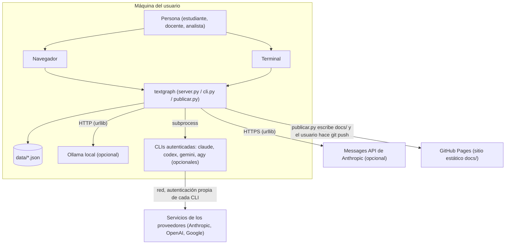
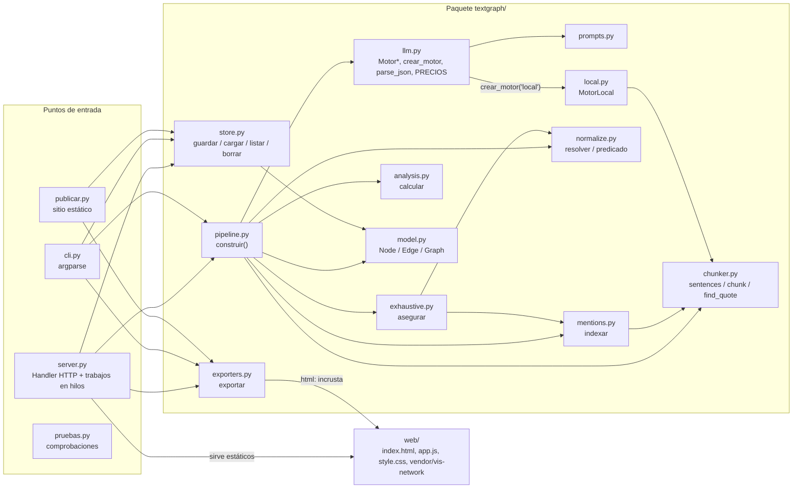
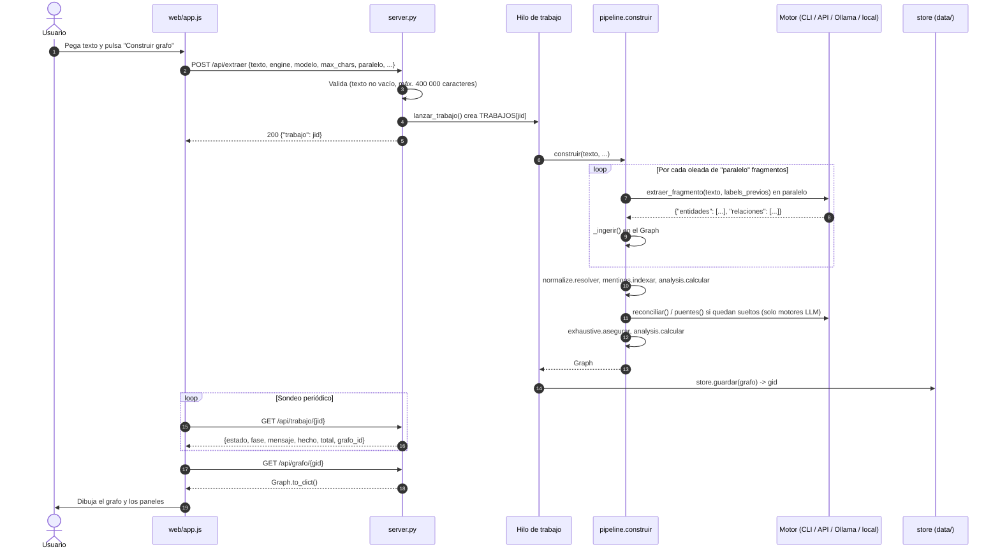
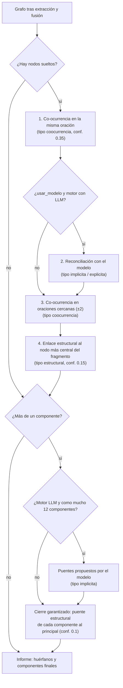
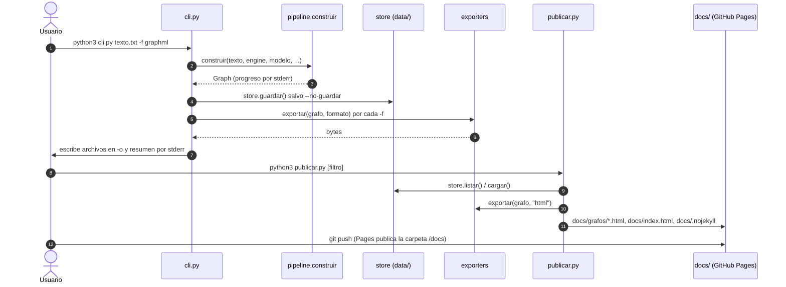

# Arquitectura de textgraph

Este documento describe cómo está construido textgraph: quién lo usa, con qué
sistemas externos habla, cómo se reparte el código y cómo fluyen los datos
desde un texto hasta un grafo exportado. Todo lo que aquí se afirma sale del
código del repositorio; donde algo no se puede determinar, se indica.

## 1. Contexto

textgraph es una aplicación **local**: corre en la máquina de quien la usa,
sobre el Python del sistema y sin dependencias. Los únicos sistemas externos
son los proveedores de modelos (a los que se llega a través de sus CLIs o de
HTTP) y, opcionalmente, GitHub Pages para publicar visores estáticos.

| Actor / sistema | Relación con textgraph |
|---|---|
| Persona usuaria | Pega o abre un texto, lanza la extracción, explora, edita y exporta. |
| Navegador | Carga la interfaz `web/` servida por `server.py` y consume la API JSON. |
| CLIs `claude`, `codex`, `gemini`, `agy` | Motores de extracción por `subprocess`; cada CLI gestiona su propia sesión. textgraph no maneja credenciales de estas CLIs. |
| Messages API | Motor `api`, por HTTPS con `ANTHROPIC_API_KEY`. |
| Ollama | Motor `ollama`, por HTTP a `OLLAMA_HOST` (por defecto `http://localhost:11434`). |
| GitHub Pages | Sirve `docs/` (índice y visores autónomos generados por `publicar.py`). |

## 2. Componentes

| Módulo | Responsabilidad |
|---|---|
| `server.py` | `ThreadingHTTPServer` con un `Handler` que sirve `web/` y la API `/api/*`. Las extracciones se lanzan en hilos *daemon* y su estado se guarda en el diccionario en memoria `TRABAJOS`, protegido por un `Lock`. |
| `cli.py` | Construye un grafo desde un archivo o la entrada estándar, lo guarda en `data/` (salvo `--no-guardar`) y escribe los formatos pedidos. |
| `publicar.py` | Exporta grafos guardados como HTML autónomo a `docs/grafos/` y genera `docs/index.html` y `docs/.nojekyll`. |
| `pipeline.py` | Orquesta las fases: fragmentar → extraer por oleadas → fusionar → indexar menciones → exhaustividad → métricas. Normaliza etiquetas y tipos devueltos por el modelo (`_limpia_label`, `_tipo`) y crea entidades citadas en relaciones pero no listadas. |
| `chunker.py` | Segmenta en oraciones conservando desplazamientos, respeta abreviaturas e iniciales, agrupa en fragmentos con solapamiento de oraciones y localiza citas de forma tolerante. |
| `llm.py` | Clase base `Motor` (reintentos de JSON, tareas `extraer_fragmento`, `reconciliar`, `puentes`, `fusiones`, contabilidad de tokens y coste) y sus implementaciones: `MotorClaudeCLI`, `MotorCodexCLI`, `MotorGeminiCLI`, `MotorAntigravityCLI`, `MotorOllama`, `MotorAPI`. Tablas de precios y modelos por defecto. `parse_json` tolerante (vallas Markdown, comas finales, texto sobrante, JSON truncado). |
| `prompts.py` | Prompt de sistema y plantillas `EXTRACCION`, `CONTEXTO_ENTIDADES`, `RECONCILIACION`, `PUENTES`, `FUSION`. |
| `local.py` | `MotorLocal`: extracción por reglas (nombres propios, siglas, fechas, cantidades, comillas) con la misma interfaz que los motores LLM; `usa_llm = False`. |
| `normalize.py` | Clave de comparación, normalización de predicados, detección de parejas candidatas indexadas por token, fusión de nodos y reescritura de aristas. |
| `mentions.py` | Índice de menciones tolerante a acentos y mayúsculas que conserva los desplazamientos exactos del texto original; la forma más larga gana. |
| `exhaustive.py` | Cascada que elimina nodos sueltos y une componentes (ver §3.2). |
| `analysis.py` | PageRank, intermediación de Brandes normalizada y comunidades por movimiento local tipo Louvain (determinista). |
| `model.py` | `Node`, `Edge`, `Graph`; deduplicación de aristas (incluida la inversa con la misma etiqueta), componentes, estadísticas y serialización. |
| `exporters.py` | Doce formatos; el HTML autónomo incrusta `index.html`, `style.css`, `app.js`, vis-network y el JSON del grafo (`window.GRAFO_EMBEBIDO`). |
| `store.py` | Un archivo JSON por grafo en `data/`; id = `slug(título)-AAAAMMDD-HHMMSS`. |
| `web/` | Interfaz de una sola página en JavaScript sin *framework*; vis-network para el dibujo. Funciona tanto contra el servidor como embebida en el HTML autónomo. |

## 3. Flujos de datos

### 3.1 Extracción desde la interfaz web

### 3.2 Cascada de exhaustividad

`exhaustive.asegurar()` se ejecuta tras indexar menciones y calcular una
primera vez las métricas (necesita PageRank para elegir el «nodo más
central»). Cada paso solo actúa sobre lo que el anterior dejó sin resolver.

El informe resultante queda en `meta.exhaustividad` del grafo (ver
[SPEC.md](SPEC.md#formato-json-del-grafo)).

### 3.3 Línea de comandos y publicación

## 4. Modelo de despliegue

| Pieza | Dónde corre | Notas |
|---|---|---|
| `server.py` + `web/` | Máquina del usuario, `127.0.0.1:8765` por defecto | Sin autenticación; `--host` permite exponerlo, bajo responsabilidad del usuario. En macOS, `iniciar.command` lo lanza con doble clic. |
| `cli.py`, `publicar.py`, `pruebas.py` | Máquina del usuario | Mismo intérprete que el servidor. |
| Motores CLI | Procesos hijos (`subprocess.run`) con tiempo límite de 300 s | Requieren la CLI en el `PATH` (`shutil.which`). |
| Motor `api` | HTTPS a `https://api.anthropic.com/v1/messages` | Tiempo límite de 300 s. |
| Motor `ollama` | HTTP a `OLLAMA_HOST` (`/api/generate`, `/api/version`) | Tiempo límite de 600 s; detección con un sondeo de 2 s. |
| Sitio de ejemplos | GitHub Pages, carpeta `/docs` de la rama `main` | Archivos estáticos generados por `publicar.py`. Los `.md` de `docs/` también quedan servidos como archivos, sin procesar (por `.nojekyll`). |

No hay tareas programadas, contenedores ni infraestructura en la nube propia.

## 5. Dependencias externas y cuotas

| Dependencia | Uso | Límite o coste |
|---|---|---|
| Biblioteca estándar de Python ≥ 3.8 | Todo | — |
| vis-network (copia minificada en `web/vendor/`) | Dibujo del grafo | Versión no determinada en el código. |
| CLI `claude` | Motor por defecto | Cuota del plan o tarifa de API; textgraph suma el `total_cost_usd` que informa la CLI. |
| CLI `codex` | Motor `codex-cli` | Coste calculado con `PRECIOS_CODEX` (entrada cacheada al 10 %). |
| CLI `gemini` | Motor `gemini-cli` | Coste calculado con `PRECIOS_GEMINI` (entrada cacheada al 10 %). |
| CLI `agy` | Motor `antigravity-cli` | Cuota del plan; coste equivalente con `PRECIOS_ANTIGRAVITY`. |
| Messages API | Motor `api` | Tarifa por token según `PRECIOS`. |
| Ollama | Motor `ollama` | Sin coste monetario. |

Las tablas de precios están codificadas en `textgraph/llm.py` y se usan solo
para mostrar un **coste equivalente** orientativo; si las tarifas públicas
cambian, hay que actualizarlas a mano.

## 6. Decisiones de diseño relevantes

Extraídas del código, sus comentarios y el historial.

1. **Cero dependencias.** HTTP crudo con `urllib` en lugar del SDK, servidor
   con `http.server` y vis-network incluido en el repo: la aplicación arranca
   con el Python que trae macOS, sin `pip install` (docstring de `llm.py`).
2. **Reutilizar CLIs ya autenticadas** como motores por defecto, para no exigir
   claves de API. Cada CLI se invoca con herramientas, configuración de usuario,
   extensiones y MCP desactivados para no inflar el contexto (según los
   comentarios de `llm.py`, sin esa precaución el coste por llamada se
   multiplicaba por unas 50).
3. **Exhaustividad como requisito**, con aristas tipificadas por respaldo
   textual (`explicita` > `implicita` > `coocurrencia` > `estructural`) para que
   el andamio sea visible y filtrable.
4. **Evidencia literal**: las citas del modelo se relocalizan en el texto con
   `find_quote`; las menciones se calculan sobre una versión sin acentos que
   conserva exactamente la longitud del original, para que los desplazamientos
   sean válidos.
5. **Extracción por oleadas**: paralelismo dentro de la oleada y propagación
   de etiquetas conocidas entre oleadas (hasta 200 etiquetas guardadas, 150
   enviadas en el prompt), equilibrio entre velocidad y coherencia de nombres.
6. **Fusión conservadora**: solo se fusiona automáticamente con confianza
   ≥ 0,7; las formas abreviadas y los «tokens casi iguales» (0,6) quedan para
   la fusión asistida por el modelo, porque en vocabulario técnico suelen ser
   productos distintos.
7. **Métricas deterministas**: el recorrido de comunidades usa un orden estable
   para que el mismo grafo produzca siempre los mismos colores.
8. **Persistencia en archivos JSON** y trabajos en memoria: simplicidad sobre
   robustez, adecuado para uso local de una sola persona.
9. **Grafos de usuario fuera de git**: `data/*.json` y `entradas/` están en
   `.gitignore` porque contienen el texto completo de entrada.
