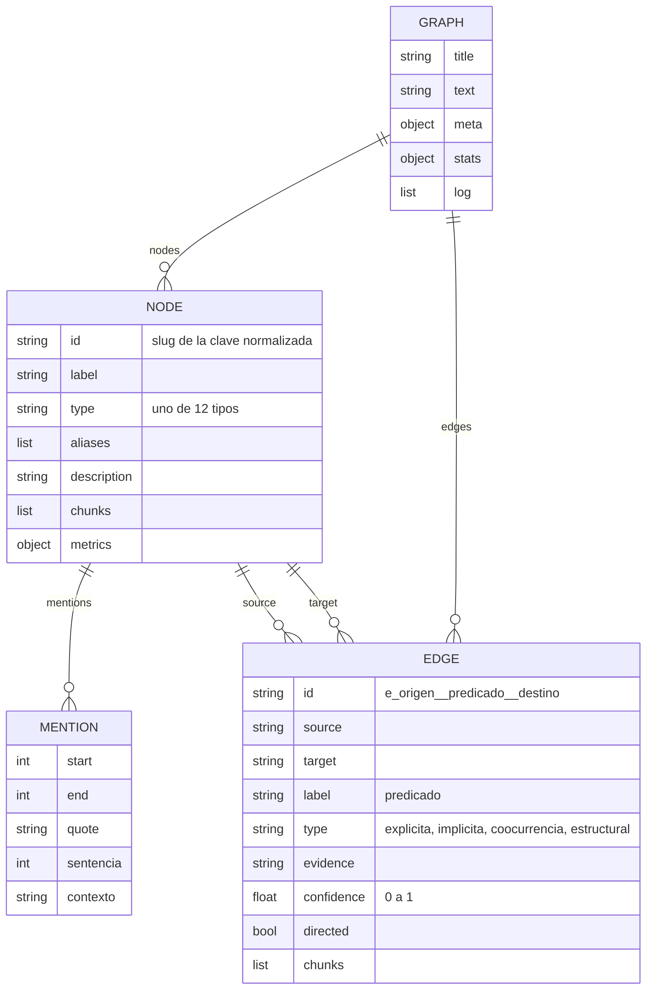
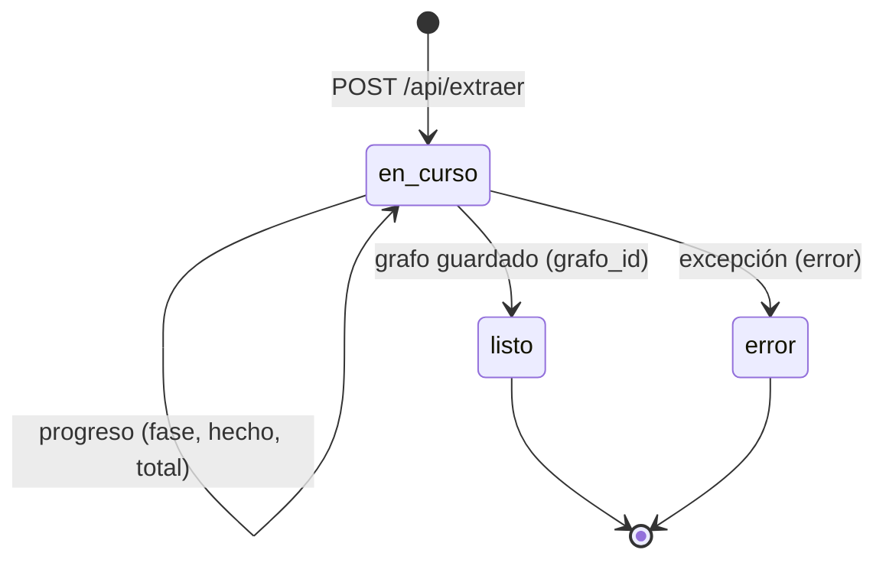

# Especificación de textgraph

Documento de *spec-driven development*: qué debe hacer textgraph, con qué
contratos y cómo se verifica. Los requisitos describen el comportamiento
actual del código (versión `1.0.0`); la columna de pruebas remite a
[TESTING.md](TESTING.md).

## 1. Propósito y alcance

**Propósito.** Convertir un texto en lenguaje natural (principalmente en
español) en un grafo de conocimiento donde las entidades son nodos y las
relaciones son aristas justificadas por citas literales, sin dejar entidades
aisladas, y permitir explorarlo, editarlo y exportarlo a formatos abiertos.

**Dentro del alcance.** Extracción con modelos de lenguaje o reglas locales;
fusión de duplicados; índice de menciones; garantía de exhaustividad; métricas
de red; interfaz web local; CLI; persistencia local en JSON; doce formatos de
exportación; generación de un sitio estático con visores autónomos.

**Fuera del alcance.** Multiusuario, autenticación, base de datos, despliegue
en servidor, ingestión de PDF u otros formatos binarios (la interfaz acepta
archivos de texto), y verificación factual de lo que afirma el texto.

## 2. Requisitos funcionales

| Id | Requisito | Módulo |
|---|---|---|
| RF-01 | Segmentar el texto en oraciones, sin cortar en abreviaturas ni iniciales, conservando los desplazamientos de cada oración en el texto original. | `chunker.sentences` |
| RF-02 | Agrupar oraciones en fragmentos de hasta `max_chars` caracteres con un solapamiento de `overlap` oraciones (2 por defecto). | `chunker.chunk` |
| RF-03 | Extraer de cada fragmento entidades (`label`, `tipo`, `aliases`, `descripcion`, `evidencia`) y relaciones (`origen`, `destino`, `etiqueta`, `tipo`, `confianza`, `evidencia`) mediante el motor elegido. | `llm.Motor.extraer_fragmento`, `local.MotorLocal` |
| RF-04 | Procesar los fragmentos en oleadas de `paralelo` llamadas simultáneas, pasando a cada oleada las etiquetas ya conocidas. | `pipeline.construir` |
| RF-05 | Normalizar lo que devuelve el modelo: quitar artículos iniciales en minúscula y comillas, mapear tipos en inglés o con acento a los 12 tipos válidos (o `OTRO`), recortar la confianza a [0, 1], normalizar predicados a minúsculas cortas. | `pipeline._limpia_label`, `pipeline._tipo`, `normalize.predicado` |
| RF-06 | Crear como nodo `OTRO` toda entidad citada en una relación pero no listada, y anotarlo en el registro. | `pipeline._ingerir` |
| RF-07 | Tolerar respuestas JSON imperfectas (vallas Markdown, comas finales, texto sobrante, JSON truncado) y reintentar hasta 2 veces pidiendo solo JSON. | `llm.parse_json`, `llm.Motor.json` |
| RF-08 | Fusionar automáticamente duplicados con confianza ≥ 0,7 (misma forma normalizada, sigla, mismos tokens, apellido de persona, singular/plural) y, si se pide, consultar al modelo los casos dudosos. | `normalize.resolver` |
| RF-09 | Localizar todas las apariciones literales de cada entidad y sus alias, tolerando acentos, mayúsculas y espacios, sin solapamientos y priorizando la forma más larga. | `mentions.indexar` |
| RF-10 | Garantizar cero nodos sueltos y un único componente conexo mediante la cascada de exhaustividad, informando cuántas aristas aportó cada paso. | `exhaustive.asegurar` |
| RF-11 | Calcular por nodo grado, PageRank, intermediación y comunidad, y el número de comunidades del grafo. | `analysis.calcular` |
| RF-12 | Exportar el grafo a 12 formatos (`json`, `graphml`, `gexf`, `csv-nodes`, `csv-edges`, `cypher`, `dot`, `mermaid`, `turtle`, `jsonld`, `llm`, `html`) y rechazar formatos desconocidos. | `exporters.exportar` |
| RF-13 | Guardar, cargar, listar (más reciente primero) y borrar grafos como archivos JSON en `data/`. | `store` |
| RF-14 | Ofrecer una API HTTP para consultar el estado, lanzar extracciones asíncronas, seguir su progreso, leer, guardar, borrar y exportar grafos (§5.1). | `server.Handler` |
| RF-15 | Ofrecer una CLI que construya un grafo desde archivo o entrada estándar y escriba los formatos pedidos (§5.2). | `cli.main` |
| RF-16 | Generar un sitio estático con un visor HTML autónomo por grafo y un índice. | `publicar.main` |
| RF-17 | Elegir automáticamente el motor (`auto`) en el orden `claude-cli`, `api`, `codex-cli`, `gemini-cli`, `antigravity-cli`, `ollama`, `local`. | `llm.crear_motor` |
| RF-18 | Contabilizar llamadas, tokens y coste equivalente por motor y guardarlo en `meta.uso`. | `llm.Motor.resumen` |
| RF-19 | Funcionar sin modelo (motor `local`) y sin red. | `local.MotorLocal` |

## 3. Requisitos no funcionales

| Id | Requisito | Cómo se cumple |
|---|---|---|
| RNF-01 Portabilidad | Ejecutar con Python ≥ 3.8 sin instalar dependencias. | Solo biblioteca estándar; vis-network incluido. Pruebas verificadas con 3.9.6 y 3.12.13. |
| RNF-02 Coste | No gastar llamadas a modelos salvo en la extracción, la reconciliación (como mucho 1 llamada, hasta 40 sueltos), los puentes (1 llamada si hay ≤ 12 componentes) y la fusión asistida opcional (1 llamada, hasta 40 parejas). | `exhaustive.paso_modelo`, `paso_componentes`, `normalize.resolver`. |
| RNF-03 Coste de contexto | Invocar las CLIs sin herramientas, ajustes de usuario, extensiones ni MCP. | Argumentos de cada `Motor*CLI.completar`. |
| RNF-04 Rendimiento | Evitar comparaciones cuadráticas en la fusión: indexar por token y descartar tokens presentes en más de 60 entidades. | `normalize.parejas_candidatas`. |
| RNF-05 Tiempos límite | 300 s por llamada a CLI o API, 600 s por llamada a Ollama, 2 s para detectar Ollama. | Constructores de los motores. |
| RNF-06 Seguridad | El servidor escucha en `127.0.0.1` por defecto; no sirve archivos fuera de `web/` (normalización de rutas); rechaza textos de más de 400 000 caracteres. | `server.main`, `Handler._estatico`, `do_POST`. |
| RNF-07 Privacidad | Los grafos guardados (que incluyen el texto completo) no se versionan. | `.gitignore` (`data/*.json`, `entradas/`). |
| RNF-08 Determinismo | Las comunidades se calculan en orden estable: el mismo grafo produce las mismas comunidades. | `analysis.comunidades`. |
| RNF-09 Trazabilidad | Toda arista conserva su evidencia y su tipo de respaldo; el registro (`log`) anota fusiones, recuperaciones y enlaces añadidos. | `model.Edge`, `Graph.log`. |
| RNF-10 Disponibilidad | No aplica: herramienta local. Los trabajos en curso se pierden si se reinicia el servidor. | `server.TRABAJOS` en memoria. |

## 4. Especificación por componente

### 4.1 Segmentación (`chunker`)

- **Entradas:** texto, `max_chars` (3500), `overlap_sents` (2).
- **Salidas:** `sentences` → `[(inicio, fin, texto)]`; `chunk` →
  `[{"i", "text", "start", "end", "sentences"}]`; `find_quote` → `(ini, fin)` o `None`.
- **Reglas:** los saltos de párrafo (línea en blanco) siempre separan; un punto
  tras una abreviatura de la lista o una inicial de 1-2 letras no corta; tras el
  signo de cierre, la siguiente oración debe empezar por mayúscula, dígito o
  signo de apertura. `find_quote` prueba coincidencia exacta, luego con espacios
  flexibles y sin mayúsculas, y para citas de más de 6 palabras, las 6 primeras.
- **Criterios de aceptación:**
  - Dado `"Junto al Dr. Pierre Curie…"`, cuando se segmenta, entonces «Dr.» y
    «Pierre» quedan en la misma oración.
  - Dado cualquier texto, `texto[ini:fin] == oración` para toda oración y
    `texto[start:end] == text` para todo fragmento.
  - Dado un texto en blanco, `chunk` devuelve `[]`.

### 4.2 Extracción y tubería (`pipeline`, `llm`, `local`)

- **Entradas de `construir`:** `texto`, `titulo` (por defecto, la primera línea
  no vacía, hasta 70 caracteres, o «Documento sin título»), `engine`, `modelo`,
  `max_chars`, `overlap`, `exhaustividad`, `fusion_llm`, `progreso` (callback con
  `fase`, `mensaje`, `hecho`, `total`), `motor` (inyección, usada en pruebas),
  `paralelo`.
- **Salida:** `Graph` con `meta` (`motor`, `modelo`, `caracteres`, `paralelo`,
  `comunidades`, `exhaustividad`, `segundos`, `uso`).
- **Fases y avisos de progreso:** `fragmentar`, `extraer`, `fusionar`,
  `indexar`, `exhaustividad`, `metricas`, `listo`; `total = fragmentos + 4`.
- **Reglas:** un error en un fragmento no aborta la construcción: se anota en
  `log` como «error en el fragmento N». Etiquetas de más de 120 caracteres se
  descartan. Las aristas a sí mismo se descartan. Una arista igual a otra
  existente (mismo origen, destino y etiqueta) o a su inversa se fusiona:
  se unen fragmentos, se conserva la mayor confianza, la evidencia más larga y
  el tipo de mayor respaldo.
- **Criterios de aceptación:**
  - Dado un motor que devuelve `{"label": "la Marie Curie", "tipo": "PERSON"}`,
    cuando se construye, entonces existe el nodo «Marie Curie» de tipo `PERSONA`.
  - Dada una relación hacia «polonio» que no está entre las entidades, entonces
    se crea el nodo «polonio» y el registro contiene «entidad recuperada».
  - Dada una confianza de 3, entonces la arista queda con confianza 1.0.
  - Dado `paralelo=1` y varios fragmentos, la segunda llamada recibe las
    etiquetas extraídas en la primera.
  - Dado un motor que lanza error, el grafo se construye y `log` contiene el error.

### 4.3 Resolución de entidades (`normalize`)

| Motivo | Confianza | ¿Fusión automática (≥ 0,7)? |
|---|---|---|
| misma forma normalizada (o alias común) | 1.0 | sí |
| sigla (`ONU` ↔ «Organización de las Naciones Unidas») | 0.95 | sí |
| mismos tokens significativos | 0.95 | sí |
| apellido (solo `PERSONA` ↔ `PERSONA`) | 0.85 | sí |
| singular/plural | 0.8 | sí |
| forma abreviada | 0.6 | no (solo con modelo) |
| tokens casi iguales | 0.6 | no (solo con modelo) |
| subconjunto de tokens | 0.5 | no (solo con modelo) |

- Tipos distintos (ninguno `OTRO`) no se comparan salvo por forma normalizada o sigla.
- Sobrevive el nodo con más tokens significativos, luego etiqueta más larga,
  luego más menciones; el absorbido pasa a alias y sus aristas se reescriben.
- **Criterios de aceptación:** «Marie Curie»/«Curie», «la Universidad de
  París»/«Universidad de Paris» y «Organización de las Naciones Unidas»/«ONU»
  quedan en 3 nodos; «Cloud Run» y «Cloud Run functions» no se fusionan sin modelo.

### 4.4 Exhaustividad (`exhaustive`)

- **Entradas:** grafo con menciones indexadas y métricas calculadas, oraciones,
  motor, texto, `usar_modelo`.
- **Salida:** informe `{huerfanos_iniciales, componentes_iniciales,
  por_coocurrencia, por_modelo, por_fragmento, por_estructura, puentes,
  huerfanos_finales, componentes_finales}`.
- **Reglas:** ver [ARCHITECTURE.md §3.2](ARCHITECTURE.md#32-cascada-de-exhaustividad).
  Los pasos con modelo solo corren si `usar_modelo` y el motor tiene
  `usa_llm = True`; sus fallos se anotan como aviso y la cascada continúa.
- **Criterio de aceptación:** dado cualquier grafo con al menos un nodo,
  después de `asegurar`, `huerfanos_finales == 0` y `componentes_finales == 1`.

### 4.5 Métricas (`analysis`)

- PageRank con amortiguación 0,85, hasta 60 iteraciones, tolerancia 1e-8, con
  redistribución de nodos colgantes.
- Intermediación de Brandes no ponderada, normalizada por `(n-1)(n-2)`.
- Comunidades: movimiento local tipo Louvain (un nivel, hasta 30 pasadas),
  numeradas de mayor a menor tamaño.
- **Criterio de aceptación:** en dos triángulos unidos por un camino, se detecta
  más de una comunidad y los nodos puente tienen mayor intermediación.

### 4.6 Persistencia (`store`)

- Directorio `data/` junto al paquete (se crea si no existe).
- `guardar(grafo, gid=None)`: id = argumento, o `meta.id`, o
  `slug(título, 40)-AAAAMMDD-HHMMSS`; fija `meta.id`, `meta.creado` (solo la
  primera vez) y `meta.modificado` (época Unix).
- `listar()` ignora archivos que no sean JSON válidos y ordena por `modificado` descendente.

### 4.7 Publicación (`publicar.py`)

- Filtra los grafos de `store.listar()` cuyo `id + " " + titulo` contenga
  alguno de los filtros (sin distinguir mayúsculas).
- Escribe `<salida>/grafos/<slug(título, 60)>.html`, `<salida>/index.html` y
  `<salida>/.nojekyll`. Devuelve 1 si no hay grafos que publicar.
- No elimina visores que ya existan en `grafos/`.

## 5. Contratos e interfaces

### 5.1 API HTTP

Servidor: `server.py`, por defecto `http://127.0.0.1:8765`. Todas las
respuestas de `/api/*` son `application/json; charset=utf-8`, salvo la
exportación. Los errores tienen la forma `{"error": "mensaje"}`. Cualquier
excepción no controlada devuelve **500**. Las rutas que no empiezan por
`/api/` se sirven como archivos estáticos desde `web/` (`/` → `index.html`;
404 si no existe o queda fuera de `web/`).

| Método | Ruta | Cuerpo | Respuesta 2xx | Errores |
|---|---|---|---|---|
| GET | `/api/estado` | — | `{motores, modelos, modelo_por_defecto, precios, formatos}` | 500 |
| GET | `/api/proyectos` | — | `{"proyectos": [ ... ]}` | 500 |
| POST | `/api/extraer` | parámetros de extracción | `{"trabajo": "<id de 12 hex>"}` | 400 falta el texto; 400 más de 400 000 caracteres |
| GET | `/api/trabajo/{id}` | — | estado del trabajo | 404 trabajo desconocido |
| GET | `/api/grafo/{id}` | — | grafo completo (§6) | 404 no existe |
| POST | `/api/grafo/{id}` | grafo completo (§6) | `{"ok": true, "id": "<id>"}` | 500 si el cuerpo no es un grafo válido |
| DELETE | `/api/grafo/{id}` | — | `{"ok": true}` o `{"ok": false}` si no existía | 404 ruta desconocida |
| GET | `/api/exportar/{id}/{formato}` | — | archivo (`Content-Disposition: attachment; filename="<slug>.<ext>"`) | 404 no existe; 400 formato desconocido |

Restricciones de los parámetros de ruta: `{id}` de trabajo `[\w-]+`; `{id}` de
grafo `[\w.-]+`; `{formato}` `[\w-]+`.

**`GET /api/estado`** (recortado):

```json
{
  "motores": {"claude-cli": true, "api": false, "codex-cli": false,
              "gemini-cli": false, "antigravity-cli": false,
              "ollama": false, "local": true},
  "modelos": {"claude-cli": ["claude-fable-5", "claude-haiku-4-5", "claude-opus-4-8",
                             "claude-opus-5", "claude-sonnet-4-6", "claude-sonnet-5"],
              "api": ["…"], "codex-cli": ["gpt-5.6-luna", "gpt-5.6-sol", "gpt-5.6-terra"],
              "gemini-cli": ["…"], "antigravity-cli": ["gemini-3.7-flash-high", "…"]},
  "modelo_por_defecto": {"claude-cli": "claude-opus-5", "api": "claude-opus-5",
                         "codex-cli": "gpt-5.6-sol", "gemini-cli": "gemini-3-pro-preview",
                         "antigravity-cli": "gemini-3.7-flash-high"},
  "precios": {"claude-opus-5": [5.0, 25.0], "gpt-5.6-sol": [4.0, 20.0], "…": []},
  "formatos": [{"id": "json", "nombre": "JSON nativo", "ext": ".json",
                "uso": "Grafo completo con evidencias y métricas"}, "…"]
}
```

`precios` está en dólares por millón de tokens `[entrada, salida]`. `modelos`
y `modelo_por_defecto` no incluyen `ollama` (ver brechas en §8).

**`POST /api/extraer`** — cuerpo:

```json
{
  "texto": "Marie Curie nació en Varsovia en 1867. …",
  "titulo": "Curie",
  "engine": "auto",
  "modelo": "claude-sonnet-5",
  "max_chars": 3500,
  "paralelo": 2,
  "exhaustividad": true,
  "fusion_llm": false
}
```

Solo `texto` es obligatorio; los valores mostrados son los predeterminados del
servidor (salvo `modelo`, que si falta o está vacío usa el del motor).
`engine` admite `auto`, `claude-cli`, `codex-cli`, `gemini-cli`,
`antigravity-cli`, `ollama`, `api`, `local`; un motor desconocido hace que el
trabajo termine en `error`.

**`GET /api/trabajo/{id}`**:

```json
{
  "id": "3f9c2a1b7d4e",
  "estado": "en_curso",
  "fase": "extraer",
  "mensaje": "Extrayendo entidades y relaciones (1-2/5)",
  "hecho": 0,
  "total": 9,
  "grafo_id": null,
  "error": null,
  "log": ["Texto dividido en 5 fragmento(s)", "Extrayendo entidades y relaciones (1-2/5)"]
}
```

`estado` ∈ {`en_curso`, `listo`, `error`}. Con `listo`, `grafo_id` contiene el
id guardado; con `error`, `error` contiene el mensaje.

**`GET /api/proyectos`**:

```json
{
  "proyectos": [
    {"id": "curie-20261025-101500", "titulo": "Curie", "nodos": 5, "aristas": 5,
     "modificado": 1792930500.12, "motor": "local", "modelo": "reglas"}
  ]
}
```

### 5.2 CLI

#### `cli.py`

```
python3 cli.py [entrada] [opciones]
```

| Argumento | Por defecto | Descripción |
|---|---|---|
| `entrada` | — (obligatorio salvo `--listar-formatos`) | Archivo de texto UTF-8, o `-` para la entrada estándar. |
| `-o`, `--salida` | `.` | Carpeta de salida (se crea si no existe). |
| `-f`, `--formato` | `json`, `html`, `llm` | Formato de exportación; repetible. Ids de §5.4. |
| `-t`, `--titulo` | nombre del archivo (o primera línea si es `-`) | Título del grafo. |
| `-m`, `--motor` | `auto` | `auto`, `claude-cli`, `codex-cli`, `gemini-cli`, `antigravity-cli`, `ollama`, `api`, `local`. |
| `--modelo` | el del motor | Modelo concreto. |
| `--fragmento` | `3500` | Tamaño máximo de fragmento en caracteres. |
| `--paralelo` | `2` | Fragmentos procesados a la vez. |
| `--sin-exhaustividad` | desactivado | No usar el modelo para conectar entidades sueltas (la cascada sin modelo sigue corriendo). |
| `--fusion-llm` | desactivado | Consultar al modelo las fusiones dudosas. |
| `--no-guardar` | desactivado | No registrar el grafo en `data/`. |
| `--listar-formatos` | — | Imprime los formatos y termina. |

Salida: archivos `<slug(título, 50)><ext>` en la carpeta de salida; progreso y
resumen por stderr. Código de salida: 0 si todo va bien; 1 si la entrada está
vacía; 2 (argparse) si falta la entrada o un argumento es inválido.

#### `server.py`

| Argumento | Por defecto | Descripción |
|---|---|---|
| `--puerto` | `8765` | Puerto TCP. |
| `--host` | `127.0.0.1` | Dirección de escucha. |
| `--sin-navegador` | desactivado | No abrir el navegador al arrancar. |

#### `publicar.py`

| Argumento | Por defecto | Descripción |
|---|---|---|
| `filtro` (0 o más) | — | Publica solo los grafos cuyo id o título contenga alguno. |
| `--salida` | `docs` | Carpeta de salida, relativa al repositorio (o absoluta). |
| `--repo` | `https://github.com/Lapeyus/textgraph` | Enlace al proyecto que aparece en el índice. |

#### `pruebas.py`

Sin argumentos. Código 0 si todas las comprobaciones pasan, 1 si alguna falla.

### 5.3 Contrato con los motores

Todo motor expone `nombre`, `modelo`, `usa_llm` y:

| Método | Devuelve |
|---|---|
| `extraer_fragmento(texto, labels_previos)` | `{"entidades": [...], "relaciones": [...]}` |
| `reconciliar(aisladas, catalogo)` | `{"relaciones": [...]}` |
| `puentes(grupos, texto, n)` | `{"relaciones": [...]}` |
| `fusiones(parejas)` | `{"fusiones": [{"a", "b", "misma", "canonico"}]}` |
| `resumen()` | `{"motor", "modelo", "llamadas", "coste_usd", "tokens_entrada", "tokens_salida"}` |

JSON que se pide al modelo en la extracción (`prompts.EXTRACCION`):

```json
{
  "entidades": [
    {"label": "Marie Curie", "tipo": "PERSONA", "aliases": ["Curie"],
     "descripcion": "física y química pionera", "evidencia": "Marie Curie nació en Varsovia"}
  ],
  "relaciones": [
    {"origen": "Marie Curie", "destino": "Varsovia", "etiqueta": "nació en",
     "tipo": "explicita", "confianza": 0.95, "evidencia": "Marie Curie nació en Varsovia"}
  ]
}
```

Los errores de los motores se señalan con `llm.ErrorMotor`.

### 5.4 Formatos de exportación

| Id | MIME | Extensión | Contenido |
|---|---|---|---|
| `json` | `application/json` | `.json` | `Graph.to_dict()` con sangría. |
| `graphml` | `application/xml` | `.graphml` | Nodos con `label, tipo, descripcion, aliases, menciones, grado, pagerank, comunidad`; aristas con `label, tipo, evidencia, confianza`. |
| `gexf` | `application/xml` | `.gexf` | Equivalente para Gephi. |
| `csv-nodes` | `text/csv` | `.nodes.csv` | `Id, Label, Tipo, Descripcion, Aliases, Menciones, Grado, PageRank, Intermediacion, Comunidad`. |
| `csv-edges` | `text/csv` | `.edges.csv` | `Source, Target, Label, Type, Tipo_relacion, Evidencia, Confianza, Source_label, Target_label`. |
| `cypher` | `text/plain` | `.cypher` | Sentencias para Neo4j. |
| `dot` | `text/vnd.graphviz` | `.dot` | Graphviz. |
| `mermaid` | `text/plain` | `.mmd` | Diagrama Mermaid. |
| `turtle` | `text/turtle` | `.ttl` | RDF Turtle. |
| `jsonld` | `application/ld+json` | `.jsonld` | JSON-LD. |
| `llm` | `text/markdown` | `.llm.md` | Entidades por tipo, tripletas con evidencia, vecindario de las 10 entidades centrales y leyenda de tipos de relación. |
| `html` | `text/html` | `.html` | Visor autónomo: `web/` + vis-network + `window.GRAFO_EMBEBIDO`. |

## 6. Modelo de datos



**Tipos de entidad:** `PERSONA`, `ORGANIZACION`, `LUGAR`, `TIEMPO`, `EVENTO`,
`OBRA`, `CONCEPTO`, `OBJETO`, `MAGNITUD`, `PROCESO`, `DISCIPLINA`, `OTRO`.

**Tipos de relación** (de mayor a menor respaldo): `explicita`, `implicita`,
`coocurrencia`, `estructural`.

### Formato JSON del grafo

Es el formato de `data/*.json`, de `GET/POST /api/grafo/{id}` y de la
exportación `json`. Ejemplo real generado con el motor local (recortado a un
nodo y una arista):

```json
{
  "title": "Curie",
  "text": "Marie Curie nació en Varsovia en 1867. Recibió el Premio Nobel de Física en 1903.",
  "meta": {
    "motor": "local", "modelo": "reglas", "caracteres": 81, "paralelo": 2,
    "comunidades": 2,
    "exhaustividad": {
      "huerfanos_iniciales": 0, "componentes_iniciales": 2,
      "por_coocurrencia": 0, "por_modelo": 0, "por_fragmento": 0,
      "por_estructura": 0, "puentes": 1,
      "huerfanos_finales": 0, "componentes_finales": 1
    },
    "segundos": 0.0,
    "uso": {"motor": "local", "modelo": "reglas", "llamadas": 1,
            "coste_usd": 0.0, "tokens_entrada": 0, "tokens_salida": 0},
    "id": "curie-20261025-101500", "creado": 1792930500.1, "modificado": 1792930500.1
  },
  "nodes": [
    {
      "id": "marie_curie", "label": "Marie Curie", "type": "PERSONA",
      "aliases": [], "description": "",
      "mentions": [{"start": 0, "end": 11, "quote": "Marie Curie", "sentencia": 0,
                    "contexto": "Marie Curie nació en Varsovia en 1867."}],
      "chunks": [0],
      "metrics": {"grado": 3, "pagerank": 0.2834, "pagerank_rel": 1.0,
                  "intermediacion": 0.6667, "intermediacion_rel": 1.0,
                  "comunidad": 0, "menciones": 1}
    }
  ],
  "edges": [
    {
      "id": "e_marie_curie__nacio_en__varsovia", "source": "marie_curie",
      "target": "varsovia", "label": "nació en", "type": "implicita",
      "evidence": "Marie Curie nació en Varsovia en 1867.",
      "confidence": 0.35, "directed": true, "chunks": [0]
    }
  ],
  "stats": {
    "nodos": 5, "aristas": 5, "componentes": 1, "huerfanos": 0, "densidad": 0.5,
    "por_tipo_entidad": {"TIEMPO": 2, "PERSONA": 1, "OTRO": 1, "EVENTO": 1},
    "por_tipo_relacion": {"implicita": 3, "coocurrencia": 1, "estructural": 1}
  },
  "log": ["puente estructural: «Premio Nobel de Física» ↔ «Marie Curie»"]
}
```

`meta.id`, `meta.creado` y `meta.modificado` los añade `store.guardar`. `stats`
se recalcula en cada serialización y se ignora al leer (`Graph.from_dict`).
Al guardar un grafo editado por `POST /api/grafo/{id}`, `nodes[].id`,
`nodes[].label`, `edges[].source`, `edges[].target` y `edges[].label` son
obligatorios; el resto tiene valores por defecto.

### Ciclo de vida de un trabajo



Los trabajos no se eliminan de memoria hasta que se detiene el servidor.

## 7. Trazabilidad

`P` = `pruebas.py` (sección), `T` = `tests/test_logica.py` (clase).

| Requisito | Módulo | Pruebas |
|---|---|---|
| RF-01, RF-02 | `chunker` | P «segmentación»; T `TestChunker` |
| RF-03, RF-04 | `pipeline`, `llm`, `local` | P «tubería completa»; T `TestTuberia` |
| RF-05, RF-06 | `pipeline`, `normalize` | T `TestTuberia.test_construir_con_motor_simulado`, `TestNormalize.test_predicado` |
| RF-07 | `llm.parse_json`, `Motor.json` | P «parseo de JSON»; T `TestLLMSinRed` |
| RF-08 | `normalize` | P «resolución de entidades»; T `TestNormalize` |
| RF-09 | `mentions` | P «índice de menciones» |
| RF-10 | `exhaustive` | P «exhaustividad»; T `TestTuberia.test_reconciliacion_del_modelo` |
| RF-11 | `analysis` | P «métricas» |
| RF-12 | `exporters` | P «exportadores»; T `TestExportadores` |
| RF-13 | `store` | T `TestStore` |
| RF-14 | `server` | T `TestServidor` |
| RF-15 | `cli` | sin prueba automática |
| RF-16 | `publicar` | T `TestPublicar` |
| RF-17 | `llm.crear_motor` | T `TestLLMSinRed.test_crear_motor`, `test_auto_cae_en_local_sin_nada_disponible` |
| RF-18 | `llm` (parseo de uso de cada CLI) | P «parseo de eventos/respuesta» de codex, gemini y antigravity |
| RF-19 | `local` | P «tubería completa con el motor local»; T `TestServidor.test_trabajo_con_motor_local` |
| RNF-06 | `server` | T `TestServidor.test_extraer_valida_texto`, `test_rutas_desconocidas_y_estaticos` |

## 8. Brechas y comportamientos a decidir

- El motor `ollama` existe en la CLI y en `auto`, pero `GET /api/estado` no
  publica su lista de modelos y la interfaz web no lo ofrece en el selector.
- `POST /api/grafo/{id}` con un cuerpo inválido responde 500 en lugar de 400.
- El límite de 400 000 caracteres solo se aplica en el servidor, no en la CLI.
- `publicar.py` no elimina visores obsoletos de `docs/grafos/`.
- Las tablas de precios están codificadas y pueden quedar desactualizadas.
